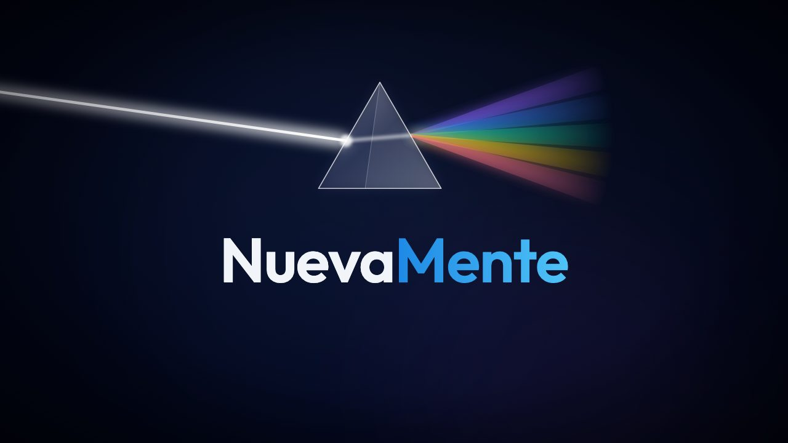
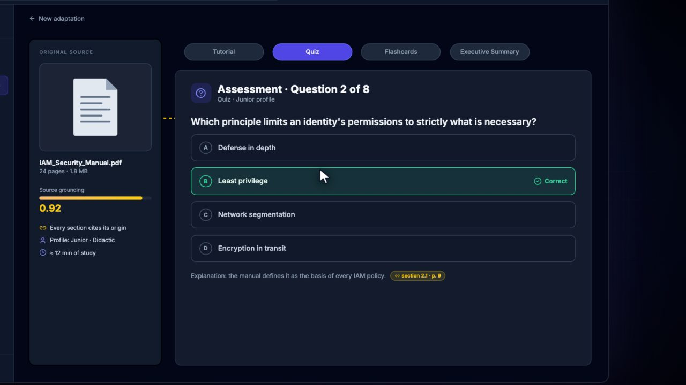
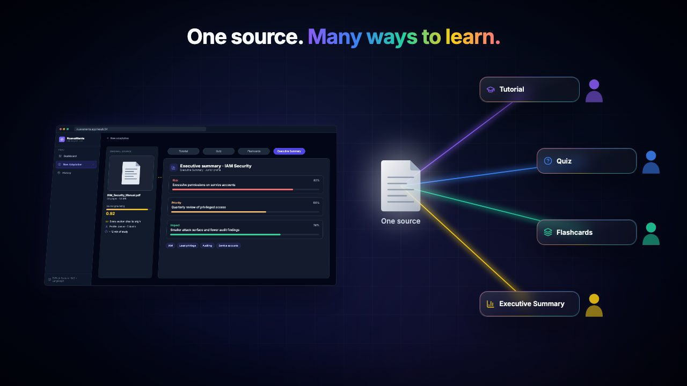
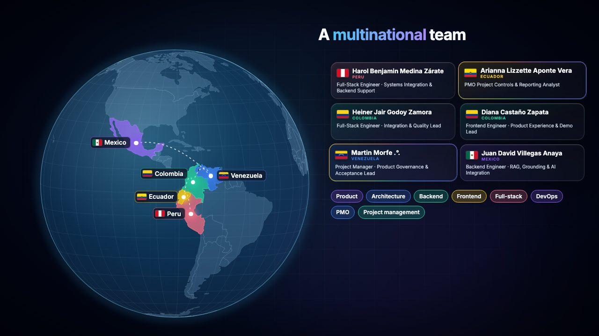
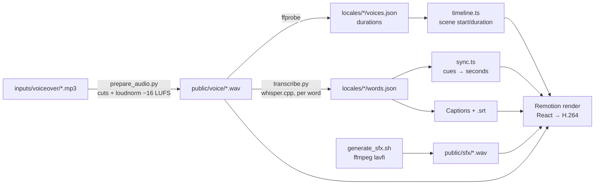

# NuevaMente · Motion Video

A ~5-minute product explainer for **NuevaMente**, built entirely in code: React components rendered to video with [Remotion](https://www.remotion.dev/), animations synced word by word to the voice-over, synthesized sound design, and one codebase that renders both the **Spanish** and the **English** cut.

No video editor was used. Every frame, caption and sound effect is reproducible from this repository.

| | |
|---|---|
|  |  |
|  |  |

> NuevaMente turns technical documentation into learning experiences adapted to each person's profile, level and needs (tutorial, quiz, flashcards, executive summary), always grounded in the original source through retrieval-augmented generation. It was built by team **G10-LATAM · Team 1** in the ONE program. The product itself lives in [bitcoinkio/nuevamente-demo-video-lab](https://github.com/bitcoinkio/nuevamente-demo-video-lab); this repository is the video about it.

## Highlights

- **Word-level sync engine.** The voice-overs are transcribed with whisper.cpp into per-word timestamps. Scenes never hard-code times: they ask for *cues* such as `"retrieval"` or `["quiz", 1]` (the second "quiz"), so re-recording a line only requires re-running the transcription. See [`src/sync.ts`](src/sync.ts).
- **One codebase, two languages.** Every string, cue, scene order and pause lives in a locale file ([`src/locales/en.tsx`](src/locales/en.tsx), [`src/locales/es.tsx`](src/locales/es.tsx)). The English pitch even plays scenes in a different order (solution before architecture). TypeScript enforces that both locales define the same keys.
- **A replica of the real product UI**, driven by a scripted virtual user: cursor path, clicks, drag-and-drop upload, the 4-step adaptation wizard and the result views. It reuses the product's design tokens (Tailwind slate/indigo, Inter, lucide icons). See [`src/ui/App.tsx`](src/ui/App.tsx) and [`src/scenes/S5.tsx`](src/scenes/S5.tsx).
- **Prism visual language** taken from the pitch deck: SVG glass prisms with an incoming white beam and spectral dispersion, liquid-glass cards with an animated rainbow border, and simple vector characters.
- **A real map.** The team scene projects Natural Earth country shapes onto an orthographic globe (d3-geo) that turns to Latin America and lights up each country as it is named.
- **Sound design from math.** Whooshes, clicks, dings, the prism shimmer and the ambient pad are synthesized with ffmpeg `lavfi` expressions, so there are no samples and no licenses ([`scripts/generate_sfx.sh`](scripts/generate_sfx.sh)).
- **Verified output.** The refactor into one codebase was checked frame by frame against the delivered renders: PSNR = ∞ (pixel-identical) on 19 of 20 sampled frames. The audio pipeline reproduces the delivered WAVs bit for bit.

## Quick start

Requirements: Node 20+, ffmpeg, Python 3. Optional: whisper.cpp (`brew install whisper-cpp`) to re-transcribe.

```bash
npm install
npm run setup        # voice-overs → normalized WAVs, and synthesized SFX + pad
npm run studio       # interactive preview (Spanish)
npm run studio:en    # interactive preview (English)
npm run render       # out/NuevaMente_es.mp4 and out/NuevaMente_en.mp4
npm run srt          # out/NuevaMente_<locale>.srt
npm run thumbnails   # out/thumbnails/*.jpg (YouTube thumbnails, captions hidden)
```

Rendering one locale takes about 10–15 minutes on an Apple Silicon laptop (≈ 8,900 frames at 1920×1080, 30 fps).

## Pipeline



## Repository layout

```
inputs/voiceover/{es,en}/   original voice-over recordings + manifest.json (provenance, cuts)
scripts/                    prepare_audio.py · generate_sfx.sh · transcribe.py · export_srt.mjs · thumbnails.mjs
src/
  locales/                  en.tsx, es.tsx (strings, cues, variants) + {es,en}/words.json, voices.json, scenes.json
  scenes/S1…S8.tsx          one file per scene / dialogue
  ui/App.tsx                replica of the NuevaMente web app
  fx/                       prism, liquid glass, characters, logo, cursor, captions, team & flags
  sync.ts · timeline.ts     word-level sync and scene timeline
docs/                       creative process, architecture, scene breakdown, dialogues
```

## Changing the video

| I want to… | Do this |
|---|---|
| Re-record a line | Replace the MP3 in `inputs/voiceover/<locale>/`, then `npm run audio && npm run transcribe`. Animations follow the new timing automatically. |
| Fix on-screen text | Edit `src/locales/<locale>.tsx`. |
| Move an animation to another word | Change its cue in `src/locales/<locale>.tsx → cue`. |
| Lengthen a pause | Edit `pre`/`tail` in `src/locales/<locale>/scenes.json`. |
| Fix a few frames without re-rendering everything | Render only that frame range and splice it in. See [docs/architecture.md](docs/architecture.md#partial-re-render). |

## Documentation

- [Creative process](docs/creative-process.md): the brief, the inputs, the decisions and every feedback iteration.
- [Architecture](docs/architecture.md): locale system, sync engine, timeline, captions, audio and rendering.
- [Scene breakdown](docs/scenes.md): which line triggers which animation, in both languages.
- [Dialogues](docs/dialogues.md): the final voice-over scripts (ES and EN).

## Credits

**G10-LATAM · Team 1**: Martin Morfe .°. (Venezuela), Heiner Jair Godoy Zamora (Colombia), Arianna Lizzette Aponte Vera (Ecuador), Harol Benjamin Medina Zárate (Peru), Diana Castaño Zapata (Colombia), Juan David Villegas Anaya (Mexico).

Creative direction and audiovisual production: **Martin Morfe .°. · [morfe.studio](https://morfe.studio)**.
Built with Claude Code as an engineering pair.

## License

The source code is released under the [MIT License](LICENSE). The voice-over recordings in `inputs/`, the NuevaMente name and logo, and the team members' names are **not** covered by the MIT license; they are included only so the video can be reproduced. All rights reserved by their owners.
